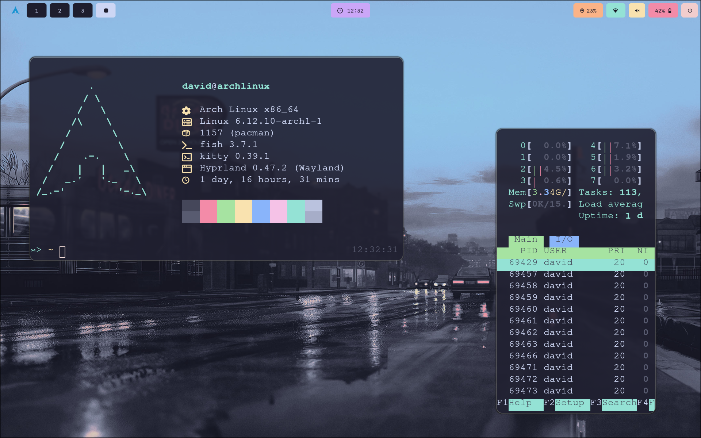
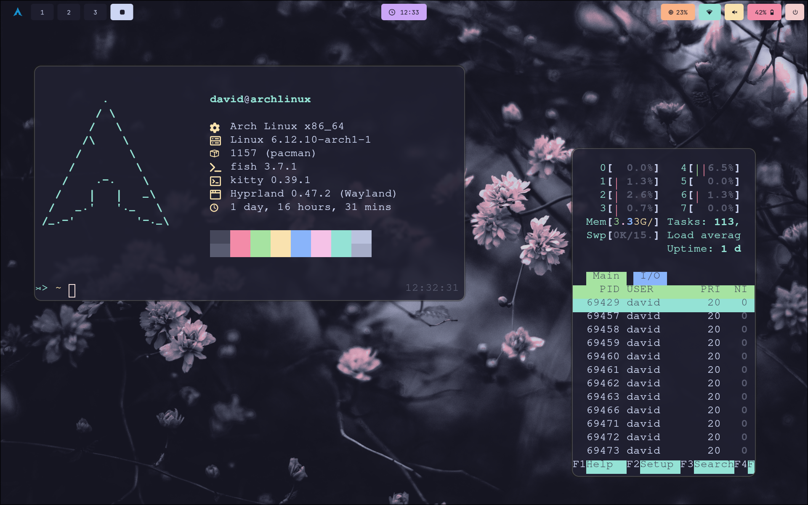
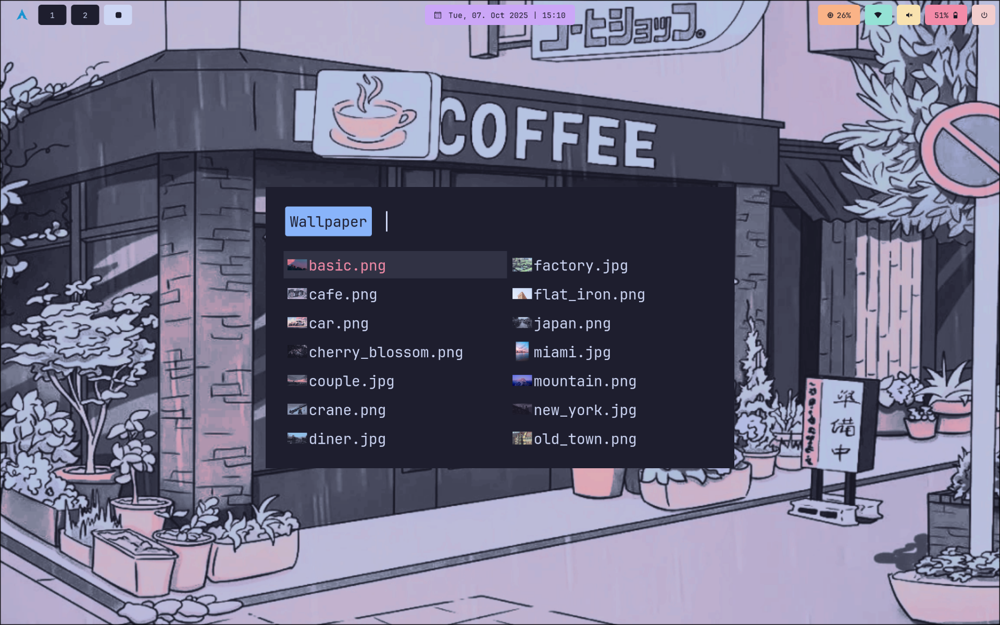
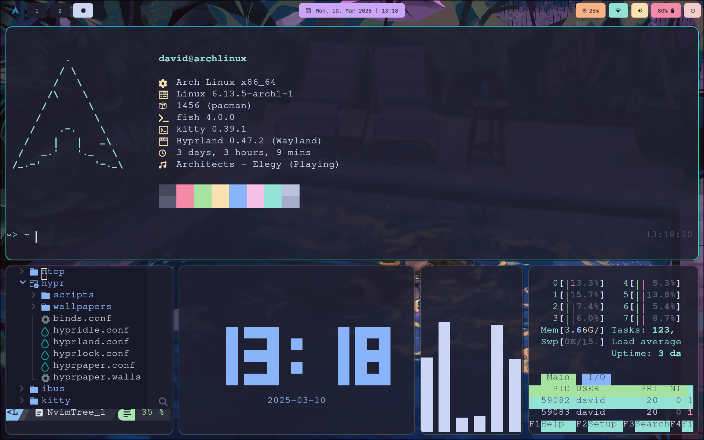
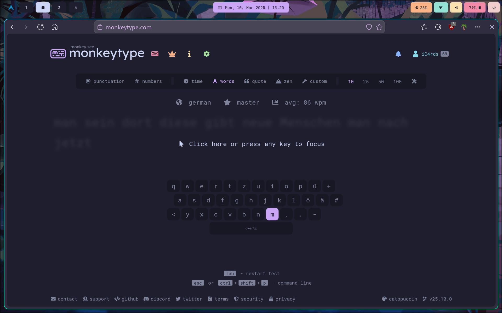
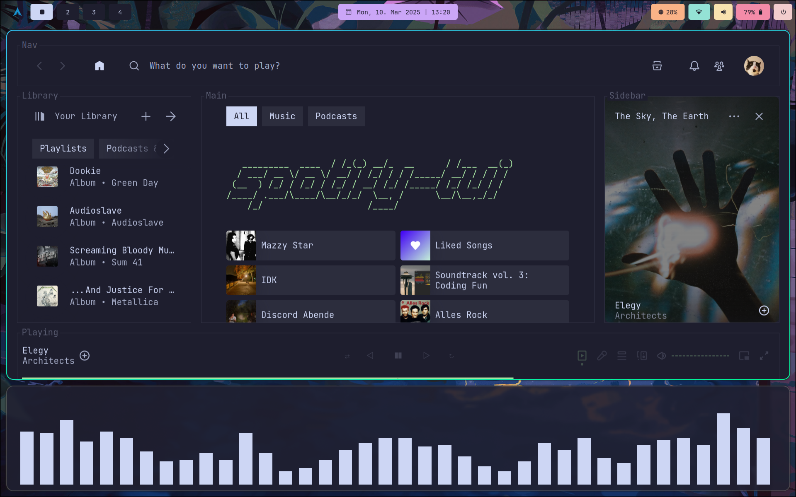
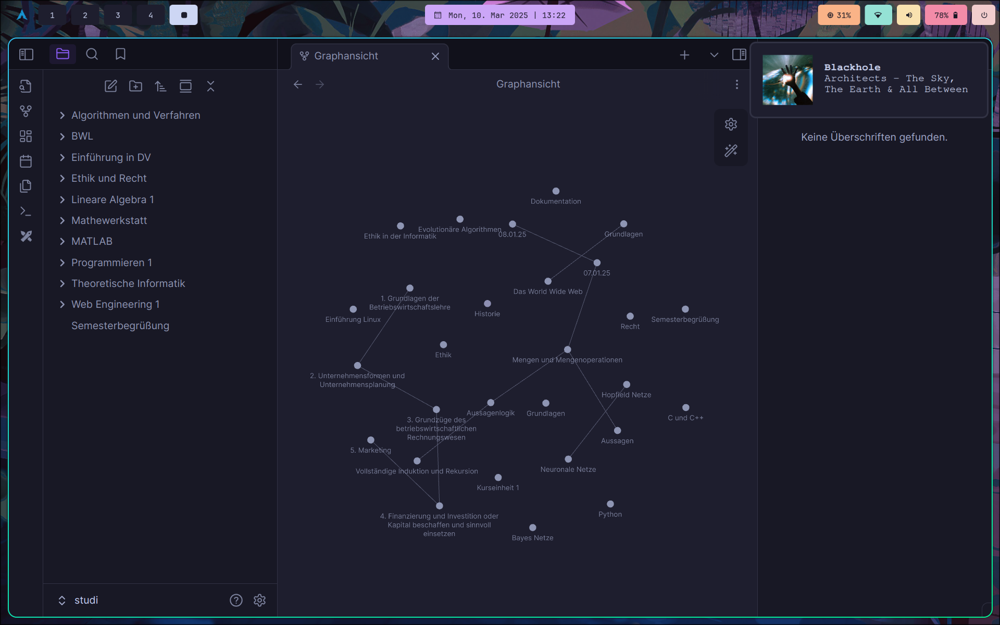

# Dotfiles

This repository contains my carefully curated dotfiles and configuration files for Arch Linux with Hyprland. These configurations reflect my personal preferences optimized for productivity and aesthetics.

## Terminal Environment  
  - `kitty`: GPU-accelerated terminal emulator  
  - `fish`: User-friendly shell with smart completions  

## System Utilities
- `waybar`: Customized status bar with workspace management  
- `rofi`/`wofi`: Efficient application launchers  
- `dunst`: Clean notification daemon setup
- Custom wallpaper changing tool with `rofi`  

## Development Tools
- `nvim`: Vim-fork focused on extensibility and usability  
- `fastfetch`: A feature-rich and performance oriented system information tool  
- `cava`: Cross-platform Audio Visualizer  
- `htop`: Interactive Process viewer  
- `tty-clock`: Clock using lib ncurses  

## Screenshots  

